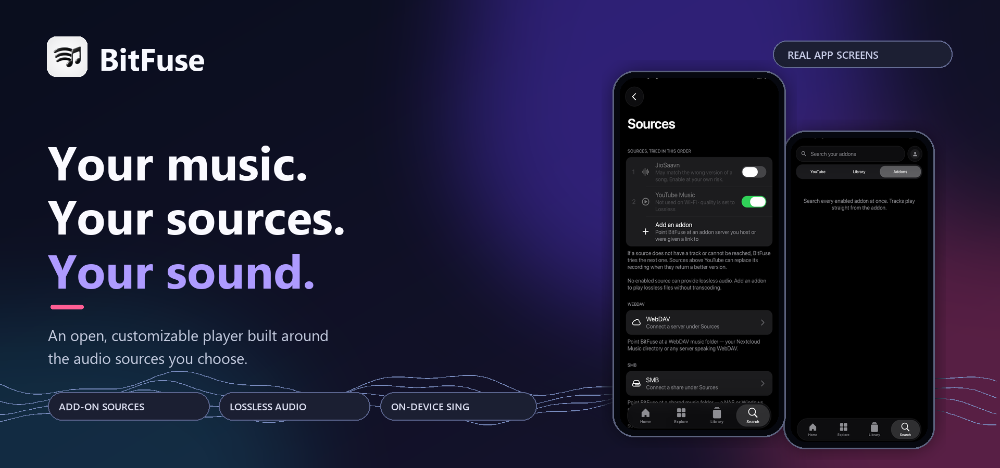
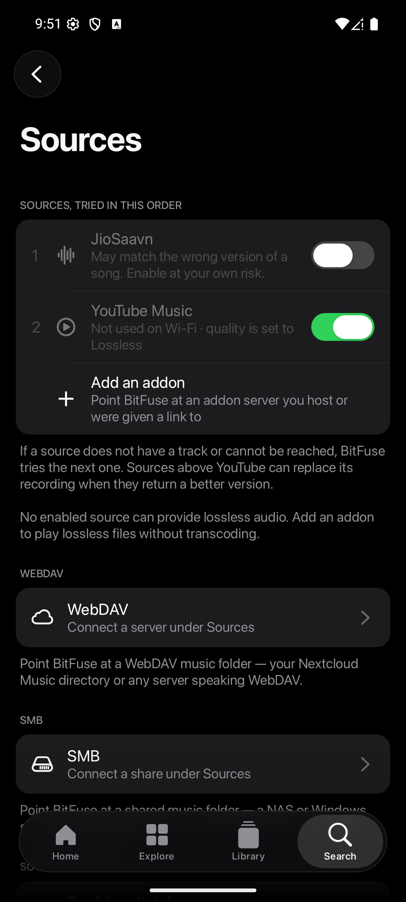
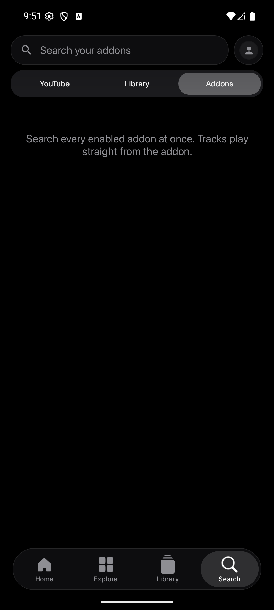

 

# BitFuse

### Your music, your sources, your sound.

[**Download**](#download) · [**Features**](#features) · [**Screenshots**](#screenshots) · [**Contributing**](#contributing) · [**Support**](#support) · [**Upstream**](#upstream)

> [!IMPORTANT]
> BitFuse is an independent community fork of BitChord. It is not an official BitChord release and is not affiliated with Google, YouTube, Spotify, SoundCloud, or their parent companies. Use it at your own discretion.

---

<h1>Features</h1>

<table>
  <tr>
    <td width="50%" valign="top">

#### Playback
- **Add-on-first playback** — use the enabled audio sources you configure. YouTube Music supplies catalog metadata; it is not the audio provider for ordinary tracks.
- **Hi-Res and lossless audio** — FLAC/ALAC from a compatible configured source.
- **Gapless playback and crossfade**, adjustable from 0–12 seconds.
- **Automix [Beta]** — DJ-style transitions with crossfade fallback.
- **Offline downloads** with embedded metadata.
- **Local music library** and background playback.
- **Sing [Beta]** — on-device vocal isolation powered by MNN.

#### Sources & Accounts
- **Spotify library sync** — browse saved tracks and playlists; playback uses your configured audio sources.
- **SoundCloud** browsing and account integration.
- **Pluggable add-on sources** — add, test, and manage providers.
- **Discord Rich Presence** and scrobbling to Last.fm or ListenBrainz.

    </td>
    <td width="50%" valign="top">

#### Listening Experience
- **Animated album artwork** and word-synced lyrics.
- **Lyrics from multiple providers**, including [LRCLIB](https://lrclib.net), [Musixmatch](https://www.musixmatch.com), and [Genius](https://genius.com).
- **Artwork-driven colors** and a frosted-glass interface.
- **Playback speed** (0.5×–2×), skip silence, and sleep timer.
- **Per-network audio quality** settings for Wi-Fi and mobile data.
- **System equalizer** and **bit-perfect USB output** for compatible DACs.
- **Stats for nerds** — inspect codec, bit depth, sample rate, and more.

    </td>
  </tr>
</table>

---

<h1>Screenshots</h1>

Captured from BitFuse running in the Android emulator. The demo install uses no signed-in accounts.

<table>
  <tr>
    <td width="50%" valign="top" align="center">
      
       <strong>Choose and manage audio sources</strong>
    </td>
    <td width="50%" valign="top" align="center">
      
       <strong>Search enabled add-ons directly</strong>
    </td>
  </tr>
</table>

---

<h1>Download</h1>

Download the latest signed APK from [BitFuse Releases](https://github.com/yangmetastasi104/BitFuse/releases). Sideloading requires enabling **Install unknown apps** for the app used to open the APK.

---

<h1>Contributing</h1>

Contributions are welcome. Please read the [Contributing Guide](CONTRIBUTING.md) and [Code of Conduct](CODE_OF_CONDUCT.md) before opening a pull request.

[**Contributing Guide**](CONTRIBUTING.md) · [**Code of Conduct**](CODE_OF_CONDUCT.md) · [**Project docs**](docs/)

---

<h1>Support</h1>

For help, bug reports, or feature requests, open an [issue in the BitFuse repository](https://github.com/yangmetastasi104/BitFuse/issues).

---

<h1>Upstream & Attribution</h1>

BitFuse is based on [BitChord](https://github.com/kushagrasinghx/BitChord). This repository is maintained independently; its fork relationship does not imply that changes are merged into BitChord.

The project remains licensed under the **GNU General Public License v3.0 (GPLv3)**. Upstream notices and third-party attributions are retained; see [LICENSE](LICENSE) and the source files for details.

